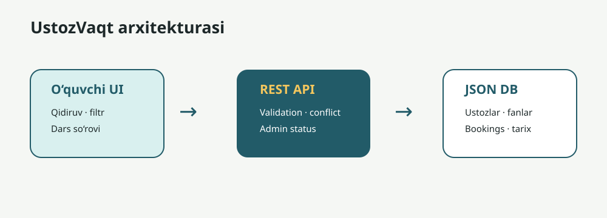

# UstozVaqt

UstozVaqt — repetitor qidirish va dars vaqtini kelishish platformasi. O‘quvchi fan, hudud va ustoz ma’lumotlari bo‘yicha izlaydi; ustozga sana-vaqt bilan so‘rov yuboradi. Muammo shundaki, repetitor topish ko‘pincha tanishlar, tarqoq e’lonlar va uzoq yozishmalarga bog‘liq. UstozVaqt boshlang‘ich qidiruv va bron oqimini bir joyga jamlaydi.



## Funksiyalar

O‘quvchi matematika, ingliz tili, fizika, kimyo yoki IT yo‘nalishidagi ustozlarni qidiradi. Fan va hudud filtrlari, ustozning tajribasi, reytingi, dars narxi, bio va dars formati ko‘rinadi. “Vaqt so‘rash” orqali sana, vaqt, ism, telefon va izoh yuboriladi. Backend bir ustozning bir vaqtda ikki marta bron qilinishini bloklaydi.

Admin yoki ustozlar paneli `x-admin-key` bilan himoyalangan. Mas’ul xodim bronlarni ko‘radi va statusni `new`, `confirmed`, `completed` yoki `cancelled`ga o‘zgartiradi. Status tarixi har bir booking ichida saqlanadi.

## Texnologiyalar

Dependency-free Node.js ES modules, built-in HTTP server, REST/JSON API, vanilla JavaScript, semantic HTML va responsive CSS ishlatilgan. Ma’lumotlar JSON faylida saqlanadi; kichik o‘quv markazi uchun sodda, keyinchalik PostgreSQL va haqiqiy akkauntlar bilan kengaytirish mumkin.

## O‘rnatish va ishga tushirish

Node.js 18+ kerak:

```bash
git clone https://github.com/RaximjonRaximov/ustozvaqt.git
cd ustozvaqt
cp .env.example .env
npm run lint
npm test
npm start
```

Brauzerda `http://localhost:3080` manzilini oching. `PORT`, `DATA_FILE` va `ADMIN_KEY` konfiguratsiyalari `.env.example`da ko‘rsatilgan. Demo panel kaliti: `demo-ustoz-admin`.

## API

`GET /api/health` server holatini, `GET /api/subjects` fanlar ro‘yxatini, `GET /api/tutors?q=Python&subject=IT%20va%20dasturlash&area=Yunusobod` ustozlarni qidiradi.

`POST /api/bookings` body namunasi:

```json
{"tutorId":"t1","date":"2026-12-01","time":"15:00","student":{"name":"Ali Valiyev","phone":"+998901234567"},"note":"Imtihonga tayyorgarlik"}
```

`GET /api/admin/bookings` va `PATCH /api/admin/bookings/:id` `x-admin-key` headerini talab qiladi. Status yangilash body: `{ "status": "confirmed" }`.

## Foydalanish

O‘quvchi qidiruv satriga ustoz yoki mavzu yozadi, fan va hududni tanlaydi. Mos ustoz kartasidagi narx, tajriba va formatni ko‘rib “Vaqt so‘rash”ni bosadi. Sana, vaqt, aloqa va izoh yuborilgach, ustoz panelida so‘rov paydo bo‘ladi. Mas’ul xodim yoki ustoz so‘rovni tasdiqlaydi va dars tugagach `completed` statusini beradi.

## Tekshiruv va cheklovlar

`npm run lint` backend va frontend JavaScript sintaksisini tekshiradi. `npm test` health, fanlar, qidiruv, admin 401 himoyasi, booking yaratish, bir xil vaqtni ikki marta bron qilishni rad etish va status yangilashni tekshiradigan 6 ta smoke testni bajaradi. Testdan so‘ng demo booking o‘chiriladi.

Hozircha login, SMS/email xabarnoma, to‘lov, taqvim sinxronizatsiyasi, video dars va ko‘p ustoz akkauntlari yo‘q. Production’da role-based auth, PostgreSQL, audit log va vaqt zonasi/taqvim qoidalarini qo‘shish kerak. Demo admin kaliti haqiqiy autentifikatsiya o‘rnini bosmaydi.
